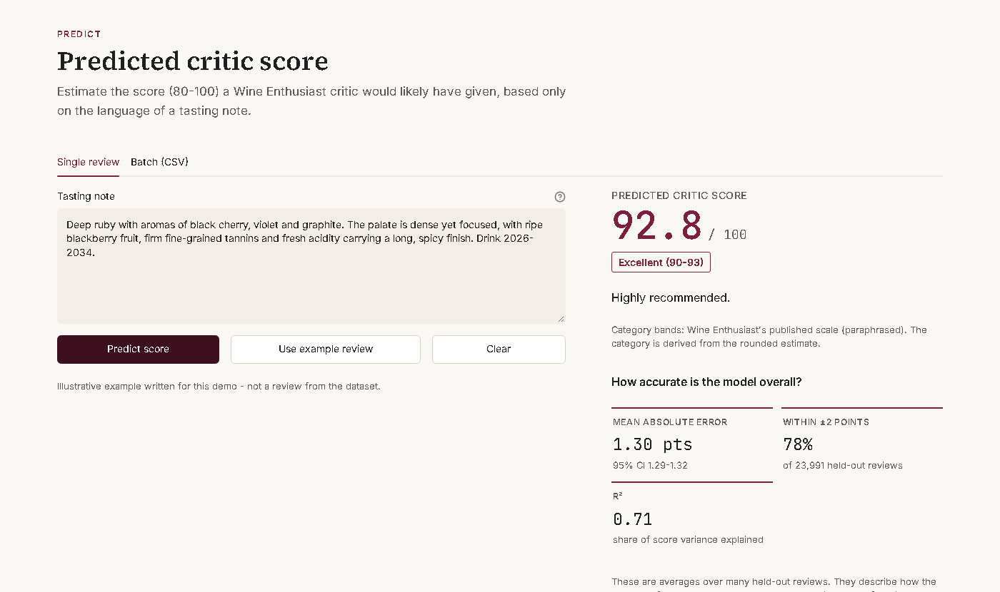
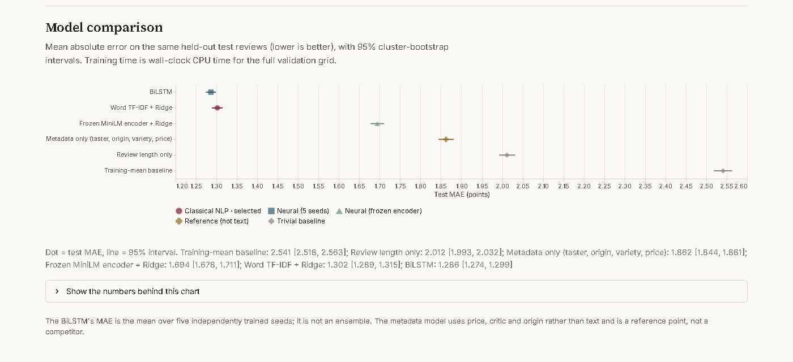
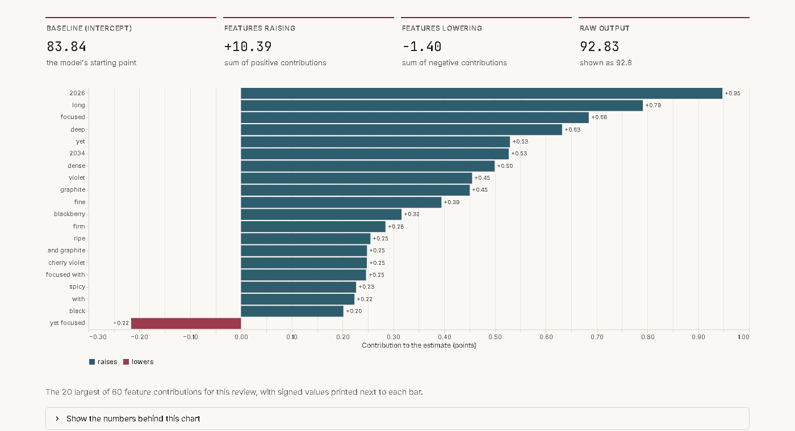

# WineMood — Natural Language Processing for Wine Review Analysis

WineMood is a reproducible NLP research project investigating how the language
used in professional wine reviews relates to the numerical ratings assigned by
critics.

The project combines rigorous dataset preparation, classical machine learning,
neural modelling, experimental evaluation, model interpretability, and an
interactive research application.

> **Scope.** WineMood predicts the score (80–100) that a Wine Enthusiast
> critic assigned to a wine, based only on the text of the review. It does not
> measure objective wine quality, and it is not sentiment analysis: the
> targets are critics' ratings, not annotated emotions.

## Project overview

Professional tasting notes are a specialised register. They are dense with
sensory vocabulary, almost uniformly positive in tone, and written by the same
expert who assigns the score. That makes them an interesting test of what
language can and cannot reveal: a model has to recover a fine-grained
numerical judgement from descriptive prose, without obvious polarity cues.

WineMood treats this as a regression problem on about 120,000 deduplicated
reviews. Every result comes from a pre-registered protocol: the test set was
evaluated once, after the models had been frozen.

## Research questions

1. **Prediction:** How accurately can review text predict the critic's score?
2. **Model complexity:** Do neural models (BiLSTM, frozen sentence encoder)
   improve on a regularised bag-of-words model?
3. **Linguistic associations:** Which words and phrases are associated with
   higher or lower scores?
4. **Reviewer generalisation:** How well do models transfer to critics who
   were absent from training?
5. **Shortcuts:** How much of the signal comes from superficial cues such as
   review length, drinking-window years or embedded score ranges?

## Key results

Results are on held-out test reviews (n = 23,991), with 95 % cluster-bootstrap
confidence intervals. MAE is mean absolute error in rating points; lower is
better.

| Model | MAE | R² |
|---|---|---|
| Training-mean baseline | 2.541 [2.518, 2.563] | 0.000 |
| Review length only | 2.012 [1.993, 2.032] | 0.331 |
| Metadata only (critic, origin, variety, price; not text) | 1.862 [1.844, 1.881] | 0.426 |
| Frozen MiniLM sentence encoder + Ridge | 1.694 [1.678, 1.711] | 0.526 |
| **Word TF-IDF + Ridge (selected model)** | **1.302 [1.289, 1.315]** | **0.715** |
| BiLSTM (mean over 5 training seeds) | 1.286 [1.274, 1.299] | 0.720 |

- **Text carries most of the signal.** The selected model is off by 1.30
  points on average, and 78 % of its predictions fall within ±2 points.
  Distinct reviews of the same wine and vintage in the dataset differ by 1.69
  points on average, so this error is of the same order as the disagreement
  between repeat expert reviews.
- **Classical vs neural.** On validation, the BiLSTM's advantage was not
  detectable (+0.004 [−0.009, +0.018] MAE), so the pre-declared rule selected
  the simpler, interpretable linear model. On test, the BiLSTM was 0.016
  points better, which is statistically detectable but practically
  negligible. The frozen general-purpose encoder performed clearly worse.
- **Unseen critics.** Retrained on critics absent from training, the TF-IDF
  model's MAE rises to 1.412, against 1.321 on a size-matched random split.
- **Shortcuts.** Review length alone explains a third of the variance. The
  presence of a drinking-window recommendation is among the strongest cues.
  Predictions regress towards the middle of the scale, which compresses
  scores at the extremes.

The full analysis is in
[experimental results](docs/experimental-results.md),
[error analysis](docs/error-analysis.md) and the
[model card](docs/model-card.md).

## Interactive application

A Streamlit application presents the selected model and the research findings.



- **Predict.** Estimates a critic score and Wine Enthusiast category for one
  review, or a CSV of up to 1,000 reviews (downloadable results). Shows the
  model's aggregate accuracy, explicitly not as a per-prediction uncertainty
  range.
- **Research.** A model comparison with confidence intervals, the
  pre-registered hypotheses and their verdicts, reviewer generalisation,
  ablations, error structure and limitations. Every number is read from the
  committed result records.
- **Explore.** Faithful feature-based explanations: for the linear model, the
  intercept plus each feature's TF-IDF weight × coefficient reconstructs the
  prediction exactly. Also the learned word and phrase associations, and the
  dataset's composition and biases.





Screenshots are from the application running locally; the example review was
written for the demo. The application has not yet been deployed publicly.

## Methodology

- **Data.** 129,971 Wine Enthusiast reviews (Kaggle *Wine Reviews*, version
  4), verified by SHA-256. Scores range from 80 to 100, because the publisher
  does not publish lower scores.
- **Leakage control.** Exact duplicate texts are removed (10,017 rows).
  Near-duplicates (MinHash) and repeat reviews of the same wine are grouped,
  so that no group spans two partitions. The data is split 70/10/20 into
  train, validation and test, stratified by category.
- **Selection on validation only.** Every learned transform is fitted on the
  training split. Hyperparameters and model choice use the validation split.
  The cross-model selection rule was committed before any test access.
- **One final evaluation.** The selection was frozen in git, and the
  pre-declared scope was evaluated once on the test set. All 19 accesses are
  logged, and no tuning followed.
- **Statistics.** Intervals use a cluster bootstrap over split groups, paired
  across models on the same test reviews. Neural models are trained with
  multiple seeds.

Design and rationale: [problem formulation](docs/problem-formulation.md),
[experimental protocol](docs/experimental-protocol.md),
[data report](docs/data-report.md).

## Technology stack

| Area | Tools |
|---|---|
| Language and data | Python 3.11–3.13, pandas, NumPy, SciPy |
| Classical ML | scikit-learn (TF-IDF, Ridge, logistic regression) |
| Neural models (optional extras) | TensorFlow/Keras (BiLSTM); PyTorch and Hugging Face Transformers (frozen MiniLM encoder) |
| Text processing | NLTK (stopwords for the legacy preprocessing variant) |
| Application and visualisation | Streamlit, Altair, matplotlib |
| Quality | pytest, Ruff, GitHub Actions |

## Getting started

Requirements: Python 3.11–3.13. The core installation does **not** include
TensorFlow or PyTorch.

```bash
git clone https://github.com/CaioVenxncio/WineMood.git
cd WineMood
python -m venv .venv
# Windows: .venv\Scripts\activate   |   macOS/Linux: source .venv/bin/activate
pip install -e ".[dev]"
pytest                                   # runs on synthetic data; no download needed
```

**Model artifact.** Trained models are not committed. Choose one option:

```bash
# Option A: rebuild the selected model from the dataset (about 6 minutes on a laptop CPU)
winemood data download                   # Kaggle dataset, checksum-verified; no credentials
winemood data split                      # deduplicated, grouped splits
winemood exp run E04_tfidf_word          # trains and validates the selected model

# Option B: install a packaged model archive (CC BY-NC-SA 4.0), once one is provided
winemood model install path/to/E04_tfidf_word.zip
```

**Run the application.**

```bash
streamlit run app.py
```

The application starts even without a model. In that case it explains how to
obtain one, while the Research page and the dataset view keep working. See
the [application guide](docs/application.md) and the
[deployment guide](docs/deployment.md).

## Repository structure

| Path | Contents |
|---|---|
| `src/winemood/data/` | Acquisition, validation, label schemes, near-duplicate detection, split protocol |
| `src/winemood/features/`, `models/` | Feature pipelines; linear, BiLSTM and frozen-encoder models; artifact packaging |
| `src/winemood/experiments/`, `evaluation/` | Experiment runner and tracking; metrics, bootstrap, error analysis, reports |
| `src/winemood/app/` | Streamlit application (UI-free services and pages) |
| `configs/` | Run configuration and the experiment matrix |
| `results/` | Committed result records: validation, selection, test, access log, report |
| `data/split_fingerprints.json` | Dataset and split fingerprints |
| `tests/` | pytest suite on synthetic fixtures |
| `docs/` | Research design, results, model card, application and deployment guides |
| `app.py` | Application entry point |

## Reproducibility

- **Configurations:** `configs/default.toml` (data, splits, seeds) and
  `configs/experiments.toml` (all 23 experiments and the test scope).
- **Records:** [`results/`](results/README.md) holds metrics, the frozen
  selection and the test-access log.
  [`data/split_fingerprints.json`](data/split_fingerprints.json) pins the
  dataset and the splits.
- **Instructions:** [reproducibility guide](docs/reproducibility.md), giving
  exact commands, environment and seeds. `winemood data split --check`
  verifies that the splits reproduce their fingerprints.

## Limitations

- **One publication, one era.** The data covers English-language Wine
  Enthusiast reviews scraped in 2017. Results may not transfer to other
  critics, publications, consumer reviews or languages.
- **Reviewer generalisation.** Accuracy drops for unseen critics, partly
  because critics calibrate scores differently.
- **Score leakage (A-31).** 669 reviews (about 0.6 %) begin with the critic's
  own provisional score range. The selected model learned these tokens; the
  measured effect on test MAE is about 0.0001. A corrected preprocessing
  version exists, and retraining under it is a separately planned experiment.
  See [A-31 remediation](docs/a31-remediation.md).
- **Source history (A-32).** An over-broad ignore rule kept the experiment
  package out of the Phase 3 commits. It was added later without rewriting
  history; reproduce from current commits. See the [audit](docs/audit.md).
- **No per-prediction uncertainty.** Only aggregate accuracy is reported.

## Licensing and attribution

- **Code:** MIT licence, see [`LICENSE`](LICENSE).
- **Dataset:** [*Wine Reviews*](https://www.kaggle.com/datasets/zynicide/wine-reviews)
  by zackthoutt (Kaggle), scraped from WineEnthusiast, licensed
  **CC BY-NC-SA 4.0**. The data is not redistributed here.
- **Dataset-derived materials:** trained model artifacts, and the short
  review excerpts and term lists in `results/` and the generated docs, fall
  under CC BY-NC-SA 4.0 (non-commercial, attribution, share-alike), not MIT.
  See [`results/README.md`](results/README.md) and
  [`data/README.md`](data/README.md).
- **Fonts:** SIL Open Font License 1.1, see
  [`static/fonts/`](static/fonts/README.md).
