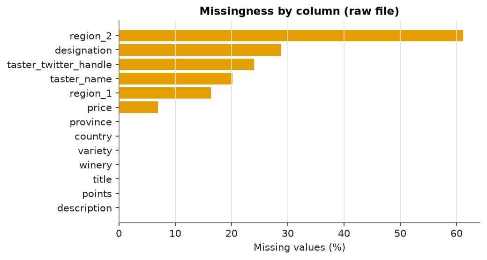
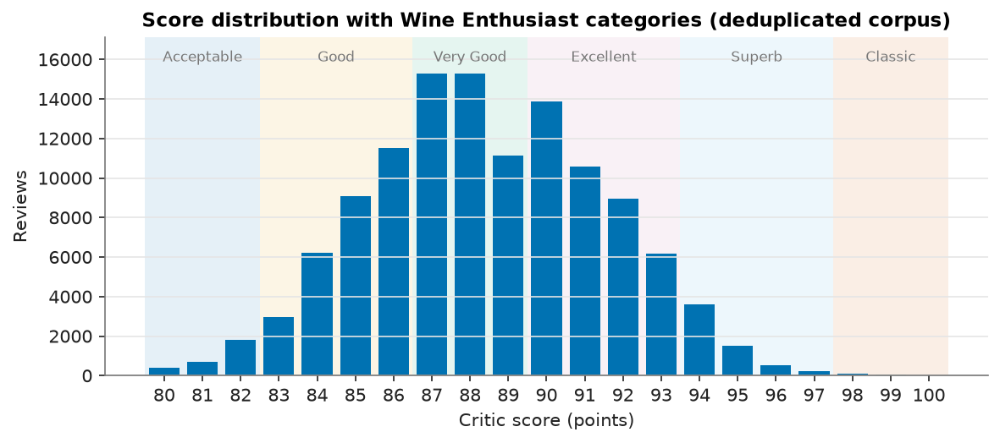
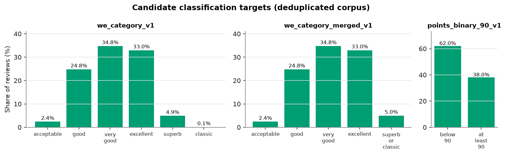
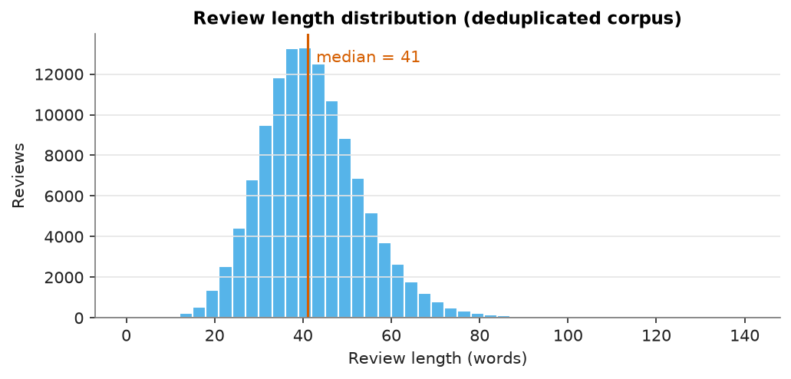
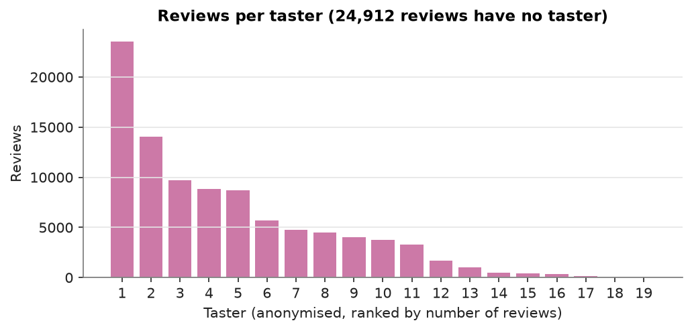
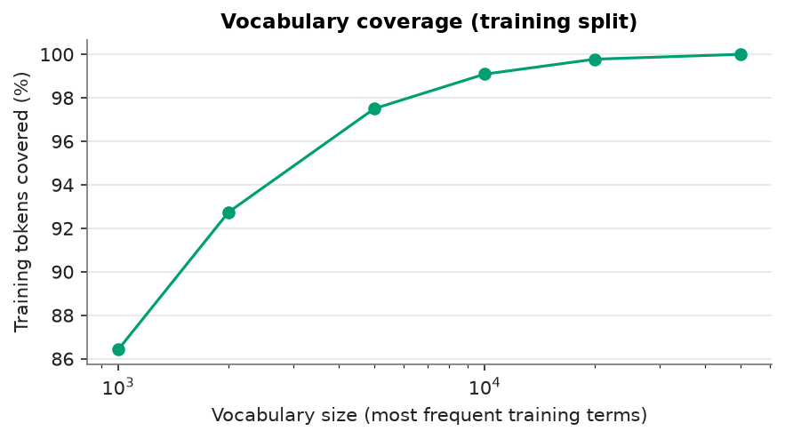
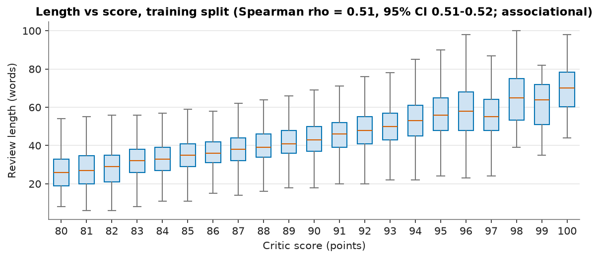
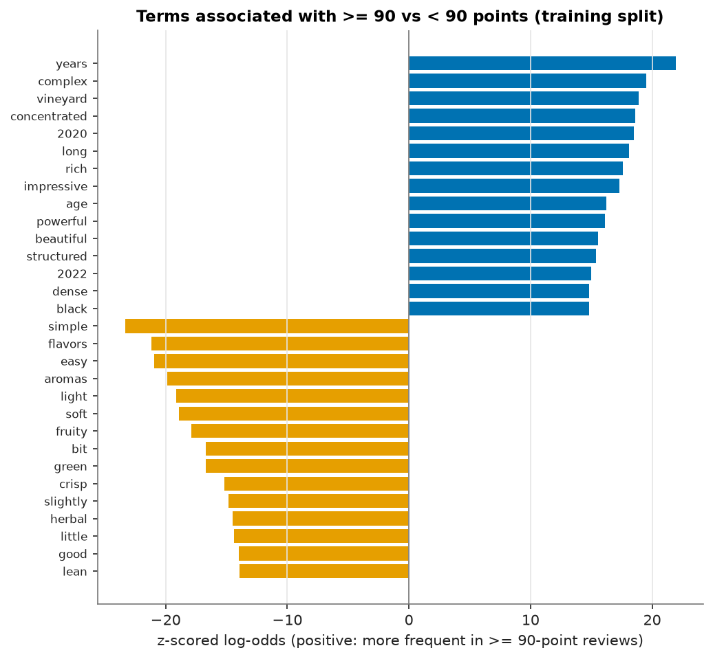

<!-- AUTO-GENERATED by `winemood data eda --publish`. Do not edit by hand; edit src/winemood/analysis/report.py and regenerate. -->

# WineMood: Data Report

Dataset SHA-256: `52af2643c8ac29f010f0cc629dfbdda1c74aa0f332d11762af9ef3de4e567ac9`. Every number in this file is produced by code (`src/winemood/analysis/`) from that exact file.

Part I describes the whole corpus. Part II is computed on the **training split only** (plus a validation out-of-vocabulary diagnostic); the test split is not read. All associations are descriptive and carry no causal interpretation.

## Part I: Descriptive statistics (whole corpus)

### Integrity

| Check | Value |
|---|---|
| Rows in raw file | 129,971 |
| Columns | 14 |
| Missing / empty descriptions | 0 / 0 |
| Descriptions with < 5 words | 2 |
| Missing / non-integer / out-of-range points | 0 / 0 / 0 |
| Points range | 80-100 |
| Exact duplicate descriptions | 10,016 |
| Duplicates after case/whitespace normalisation | 10,017 |
| Fully duplicated rows (all columns except id) | 9,983 |
| Rows repeating an earlier `title` | 11,131 |
| Texts with control characters | 0 |
| Texts with U+FFFD replacement characters | 0 |
| Texts with suspected mojibake | 2 |
| Texts containing non-ASCII characters | 20,001 |

After exact deduplication (normalised text, lowest `review_id` kept): **119,954 rows**. Distributions below use the deduplicated corpus.

### Critic scores

Mean 88.44, SD 3.09, median 88, range 80-100. No review scores below 80, consistent with Wine Enthusiast's policy of not publishing wines under 80 points.

### Candidate targets

`we_category_v1` (published Wine Enthusiast categories):

| Class | Reviews | Share |
|---|---|---|
| acceptable | 2,898 | 2.42% |
| good | 29,775 | 24.82% |
| very_good | 41,702 | 34.76% |
| excellent | 39,563 | 32.98% |
| superb | 5,887 | 4.91% |
| classic | 129 | 0.11% |

Imbalance ratio (largest / smallest class): 323.3.

`we_category_merged_v1` (Classic merged into Superb by the pre-declared rule):

| Class | Reviews | Share |
|---|---|---|
| acceptable | 2,898 | 2.42% |
| good | 29,775 | 24.82% |
| very_good | 41,702 | 34.76% |
| excellent | 39,563 | 32.98% |
| superb_or_classic | 6,016 | 5.02% |

Imbalance ratio: 14.4.

`points_binary_90_v1`:

| Class | Reviews | Share |
|---|---|---|
| below_90 | 74,375 | 62.00% |
| at_least_90 | 45,579 | 38.00% |

Legacy `points_band_v0` (deprecated; shown for the record):

| Class | Reviews | Share |
|---|---|---|
| negative | 0 | 0.00% |
| neutral | 74,375 | 62.00% |
| positive | 45,579 | 38.00% |

Empty classes in `points_band_v0`: ['negative'].

### Review length

Words per review: mean 41.6, SD 11.5, median 41, 5th-95th percentile 24-62, max 138. Spearman correlation between length and points (whole corpus): 0.512.

| WE category | Median words |
|---|---|
| acceptable | 28 |
| good | 35 |
| very_good | 39 |
| excellent | 46 |
| superb | 54 |
| classic | 64 |

### Metadata and sampling

43 countries; the most frequent are: US (50,447), France (20,351), Italy (17,921), Spain (6,116), Portugal (5,256).

707 varieties; the most frequent are: Pinot Noir (12,277), Chardonnay (10,867), Cabernet Sauvignon (8,837), Red Blend (8,239), Bordeaux-style Red Blend (6,469).

Price: missing for 8,388 rows; median 25, 95th percentile 85. Spearman (price, points) = 0.613.

Tasters: 19 named tasters; 24,912 reviews have no taster. The largest taster wrote 19.64% of all reviews. Mean score per taster ranges from 85.78 to 90.63. Tasters are reported anonymously.

Vintage (parsed from `title`): median 2011, 5th-95th percentile 2004-2015; not parseable for 4,294 titles.

## Split protocol results

Exact deduplication removed 10,017 rows (10,011 duplicate groups; 23 groups whose copies carry different scores).

Near-duplicates (MinHash/LSH, verified word-3-gram Jaccard >= threshold): 26 pairs covering 52 rows. 2,099 rows share a `title` (same wine and vintage) with another row. Union of these links: 118,773 groups, 963 with more than one row (largest: 9).

| Split (grouped_v1) | Rows | Share | ID fingerprint (SHA-256, first 16) |
|---|---|---|---|
| train | 83,967 | 70.00% | `6a6a98f390a9d98e` |
| validation | 11,996 | 10.00% | `4e01e2d247949916` |
| test | 23,991 | 20.00% | `acad281f233f69d6` |

| Split (taster_holdout_v1) | Rows |
|---|---|
| train | 57,631 |
| validation | 17,795 |
| test | 19,554 |
| excluded | 24,974 |

## Part II: Modelling-relevant analysis (training split only)

Training rows: 83,967. Vocabulary (lower-cased word tokens): 27,430 types, 10,403 occurring at least 5 times.

| Top-k training terms | Training tokens covered | Validation OOV rate |
|---|---|---|
| 1,000 | 86.42% | 17.49% |
| 2,000 | 92.74% | 11.45% |
| 5,000 | 97.50% | 6.97% |
| 10,000 | 99.09% | 5.53% |
| 20,000 | 99.78% | 4.99% |
| 50,000 | 100.00% | 4.84% |

Length vs points (training split): Spearman rho = 0.511 (95% bootstrap CI 0.506 to 0.516, n = 83,967). Length is therefore a strong candidate shortcut, so the experimental protocol requires a length-only baseline.

| Length decile (words) | Mean points | Reviews |
|---|---|---|
| (3.999, 28.0] | 85.69 | 9,304 |
| (28.0, 32.0] | 86.84 | 8,485 |
| (32.0, 35.0] | 87.38 | 8,309 |
| (35.0, 38.0] | 87.88 | 9,342 |
| (38.0, 41.0] | 88.31 | 9,381 |
| (41.0, 43.0] | 88.70 | 5,847 |
| (43.0, 47.0] | 89.17 | 10,387 |
| (47.0, 50.0] | 89.62 | 6,202 |
| (50.0, 56.0] | 90.20 | 8,475 |
| (56.0, 129.0] | 91.26 | 8,235 |

Most frequent n-grams (English stop words removed):

| Unigram | Count | Bigram | Count | Trigram | Count |
|---|---|---|---|---|---|
| wine | 51933 | black cherry | 5228 | fine grained tannins | 675 |
| flavors | 40589 | fruit flavors | 4766 | wine ready drink | 634 |
| fruit | 32201 | cabernet sauvignon | 3389 | black fruit flavors | 512 |
| aromas | 25303 | ready drink | 2755 | new french oak | 498 |
| palate | 24506 | palate offers | 2596 | medium bodied wine | 470 |
| finish | 22514 | black fruit | 2285 | red berry fruits | 429 |
| acidity | 22423 | medium bodied | 2251 | dried black cherry | 411 |
| tannins | 19733 | pinot noir | 2069 | blend cabernet sauvignon | 384 |
| drink | 19555 | black currant | 1956 | ripe black cherry | 371 |
| cherry | 18880 | red berry | 1940 | cabernet sauvignon merlot | 360 |
| black | 18640 | black pepper | 1834 | red fruit flavors | 360 |
| ripe | 17624 | drink 2018 | 1782 | black cherry fruit | 355 |
| red | 13971 | red fruit | 1748 | palate offers dried | 311 |
| spice | 12439 | white pepper | 1660 | juicy black cherry | 274 |
| notes | 12228 | red cherry | 1583 | medium bodied palate | 273 |

Terms most associated with >= 90 versus < 90 points (weighted log-odds with an informative Dirichlet prior; Monroe, Colaresi & Quinn, 2008). These are associations in the training data, not evidence of what makes a wine good.

| Favours >= 90 | z | Favours < 90 | z |
|---|---|---|---|
| years | 21.9 | simple | -23.3 |
| complex | 19.5 | flavors | -21.2 |
| vineyard | 18.9 | easy | -21.0 |
| concentrated | 18.6 | aromas | -19.9 |
| 2020 | 18.5 | light | -19.1 |
| long | 18.1 | soft | -18.9 |
| rich | 17.6 | fruity | -17.9 |
| impressive | 17.3 | bit | -16.7 |
| age | 16.2 | green | -16.7 |
| powerful | 16.1 | crisp | -15.2 |
| beautiful | 15.6 | slightly | -14.8 |
| structured | 15.4 | herbal | -14.5 |
| 2022 | 15.0 | little | -14.4 |
| dense | 14.8 | good | -14.0 |
| black | 14.8 | lean | -13.9 |

### Merge rule check

Re-deriving the pre-declared merge rule (min class share 1.00%) on the training split gives classes ['acceptable', 'good', 'very_good', 'excellent', 'superb_or_classic']; matches the frozen `we_category_merged_v1`: **True**.
