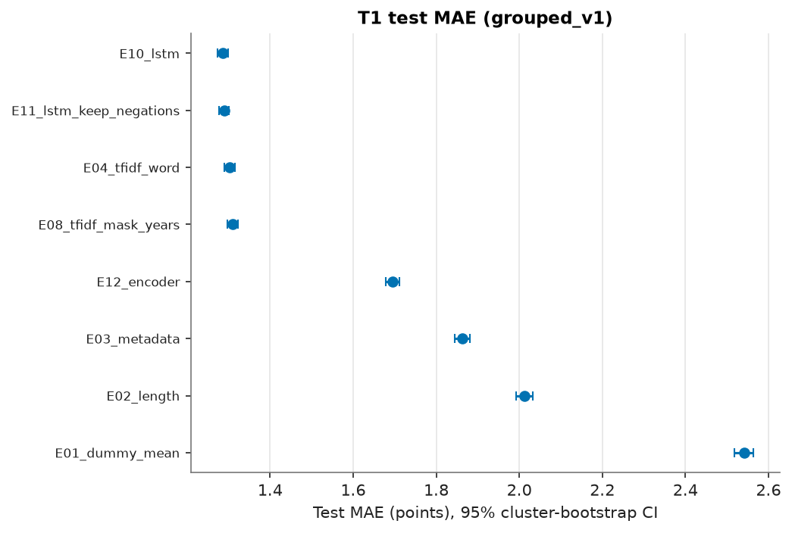
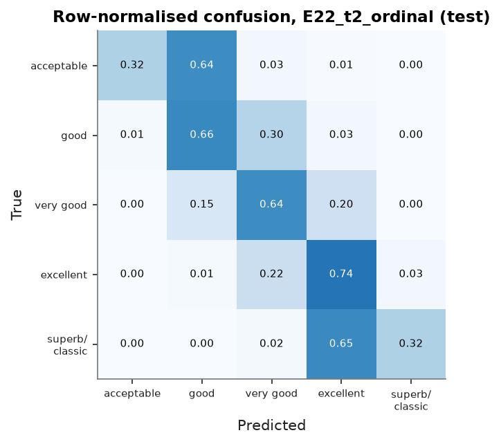
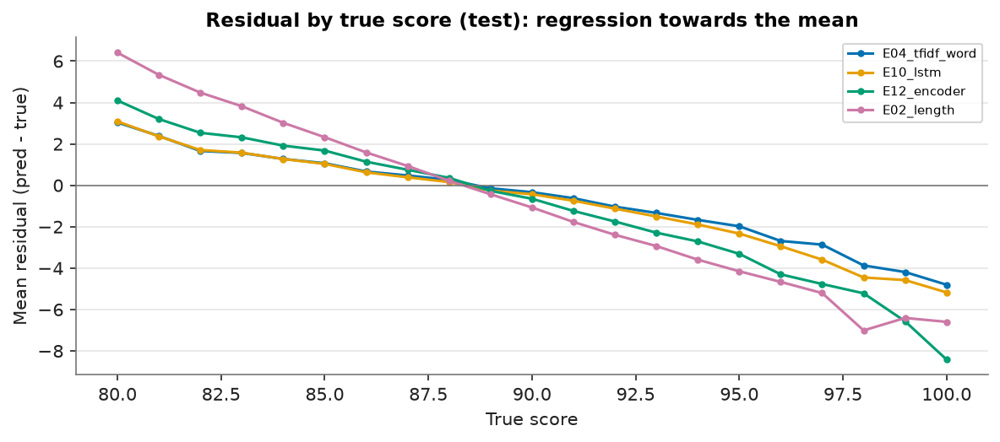
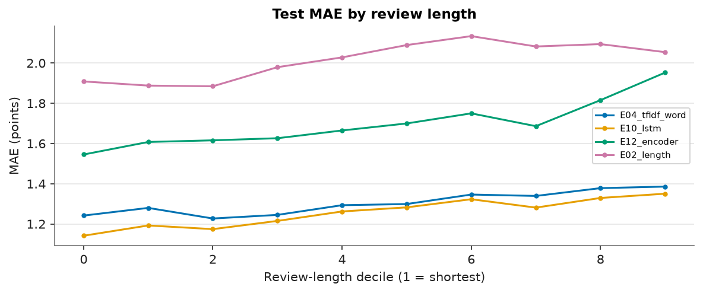

<!-- AUTO-GENERATED by `winemood exp report`. Do not edit by hand; every number is recomputed from results/ and experiments/ predictions. -->

# WineMood: Results Tables (generated)

Generated 2026-10-13T02:30:06+00:00. Bootstrap: 2000 cluster resamples over split groups; intervals are 95 % percentile intervals. MAE, RMSE and bias are in points.

## Validation results (development set; used for selection)

| Experiment | Task | Split | Configs | Metric | Validation value | Seeds |
|---|---|---|---|---|---|---|
| E01_dummy_mean | T1 | grouped_v1 | 1 | mae | 2.5397 | 1 |
| E02_length | T1 | grouped_v1 | 1 | mae | 2.0197 | 1 |
| E03_metadata | T1 | grouped_v1 | 7 | mae | 1.8305 | 1 |
| E04_tfidf_word | T1 | grouped_v1 | 84 | mae | 1.2906 | 1 |
| E05_tfidf_char | T1 | grouped_v1 | 7 | mae | 1.2910 | 1 |
| E06_tfidf_word_char | T1 | grouped_v1 | 7 | mae | 1.2517 | 1 |
| E07_tfidf_plus_length | T1 | grouped_v1 | 1 | mae | 1.2665 | 1 |
| E08_tfidf_mask_years | T1 | grouped_v1 | 1 | mae | 1.3005 | 1 |
| E09_tfidf_mask_all | T1 | grouped_v1 | 1 | mae | 1.3030 | 1 |
| E13_tfidf_keep_negations | T1 | grouped_v1 | 1 | mae | 1.3244 | 1 |
| E10_lstm | T1 | grouped_v1 | 8 | mae | 1.2862 ± 0.0082 | 5 |
| E11_lstm_keep_negations | T1 | grouped_v1 | 1 | mae | 1.2886 ± 0.0091 | 5 |
| E12_encoder | T1 | grouped_v1 | 7 | mae | 1.6843 | 1 |
| E20_t2_majority | T2 | grouped_v1 | 1 | macro_f1 | 0.1032 | 1 |
| E20b_t2_stratified | T2 | grouped_v1 | 1 | macro_f1 | 0.1974 | 1 |
| E21_t2_logistic | T2 | grouped_v1 | 10 | macro_f1 | 0.5765 | 1 |
| E22_t2_ordinal | T2 | grouped_v1 | 4 | macro_f1 | 0.5723 | 1 |
| E30_t3_majority | T3 | grouped_v1 | 1 | macro_f1 | 0.3827 | 1 |
| E31_t3_logistic | T3 | grouped_v1 | 10 | macro_f1 | 0.8392 | 1 |
| E40_holdout_tfidf | T1 | taster_holdout_v1 | 84 | mae | 1.5675 | 1 |
| E42_random_tfidf | T1 | taster_random_v1 | 84 | mae | 1.2997 | 1 |
| E41_holdout_lstm | T1 | taster_holdout_v1 | 1 | mae | 1.5010 ± 0.0057 | 3 |
| E43_random_lstm | T1 | taster_random_v1 | 1 | mae | 1.2929 ± 0.0096 | 3 |

### Validation-only ablations relative to B3* (E04)

Best E04 validation MAE per preprocessing version (ablation D): `norm_min_v1` 1.2906, `norm_legacy_v0` 1.3177.

| Variant | Validation MAE | Δ MAE vs B3* [95% CI] (negative = better) |
|---|---|---|
| E05_tfidf_char: Ablation C: character n-grams (char_wb 3-5) instead of words | 1.2910 | +0.0004 [-0.0124, +0.0125] |
| E06_tfidf_word_char: Ablation C: word + character n-grams | 1.2517 | -0.0389 [-0.0463, -0.0319] |
| E07_tfidf_plus_length: Protocol ablation: B3* plus standardised length features | 1.2665 | -0.0241 [-0.0310, -0.0171] |
| E08_tfidf_mask_years: H4: B3* with 19xx/20xx years masked (__year__) | 1.3005 | +0.0099 [+0.0066, +0.0128] |
| E09_tfidf_mask_all: Diagnostic: B3* with every digit run masked (__num__) | 1.3030 | +0.0124 [+0.0086, +0.0163] |
| E13_tfidf_keep_negations: Ablation D: B3* with the legacy pipeline minus negation removal | 1.3244 | +0.0338 [+0.0221, +0.0454] |

## Model selection (validation)

Rule: Primary criterion: validation MAE on grouped_v1 (T1). Candidates in order of complexity: E04_tfidf_word, E12_encoder, E10_lstm. A more complex candidate replaces the current choice only if it has lower validation MAE AND the 95% paired cluster-bootstrap CI of the MAE difference excludes 0.

Selected final model: **E04_tfidf_word** (frozen 2026-10-13T01:57:30+00:00).

| Current | Candidate | MAE(current) - MAE(candidate) [95% CI] | Switch |
|---|---|---|---|
| E04_tfidf_word | E12_encoder | -0.3937 [-0.4155, -0.3710] | False |
| E04_tfidf_word | E10_lstm | +0.0044 [-0.0091, +0.0180] | False |

## Test results: T1 score regression

| Experiment | Split | n | MAE [95% CI] | RMSE [95% CI] | R² [95% CI] | Bias [95% CI] | MedAE | Within ±2 | Seeds (MAE SD) |
|---|---|---|---|---|---|---|---|---|---|
| E01_dummy_mean | grouped_v1 | 23,991 | 2.541 [2.518, 2.563] | 3.099 [3.073, 3.123] | -0.000 [-0.000, -0.000] | +0.004 [-0.034, +0.042] | 2.442 | 46.3% | 1 |
| E02_length | grouped_v1 | 23,991 | 2.012 [1.993, 2.032] | 2.534 [2.511, 2.558] | 0.331 [0.321, 0.342] | +0.002 [-0.029, +0.035] | 1.681 | 57.4% | 1 |
| E03_metadata | grouped_v1 | 23,991 | 1.862 [1.844, 1.881] | 2.349 [2.326, 2.372] | 0.426 [0.416, 0.435] | +0.021 [-0.008, +0.050] | 1.571 | 61.1% | 1 |
| E04_tfidf_word | grouped_v1 | 23,991 | 1.302 [1.289, 1.315] | 1.655 [1.639, 1.671] | 0.715 [0.709, 0.720] | +0.045 [+0.024, +0.066] | 1.082 | 78.1% | 1 |
| E08_tfidf_mask_years | grouped_v1 | 23,991 | 1.310 [1.297, 1.323] | 1.664 [1.648, 1.680] | 0.712 [0.706, 0.717] | +0.047 [+0.027, +0.069] | 1.088 | 77.7% | 1 |
| E10_lstm | grouped_v1 | 23,991 | 1.286 [1.274, 1.299] | 1.640 [1.624, 1.656] | 0.720 [0.714, 0.725] | -0.048 [-0.067, -0.028] | 1.058 | 78.6% | 5 (0.007) |
| E11_lstm_keep_negations | grouped_v1 | 23,991 | 1.289 [1.276, 1.302] | 1.643 [1.627, 1.658] | 0.719 [0.713, 0.724] | -0.079 [-0.099, -0.059] | 1.060 | 78.6% | 5 (0.008) |
| E12_encoder | grouped_v1 | 23,991 | 1.694 [1.678, 1.711] | 2.132 [2.112, 2.152] | 0.526 [0.518, 0.535] | -0.008 [-0.036, +0.020] | 1.426 | 65.6% | 1 |
| E40_holdout_tfidf | taster_holdout_v1 | 19,554 | 1.412 [1.397, 1.428] | 1.788 [1.769, 1.807] | 0.571 [0.561, 0.581] | +0.143 [+0.119, +0.169] | 1.180 | 74.7% | 1 |
| E41_holdout_lstm | taster_holdout_v1 | 19,554 | 1.364 [1.349, 1.378] | 1.739 [1.721, 1.757] | 0.594 [0.585, 0.603] | -0.018 [-0.041, +0.006] | 1.126 | 76.3% | 3 (0.028) |
| E42_random_tfidf | taster_random_v1 | 19,554 | 1.321 [1.306, 1.335] | 1.670 [1.652, 1.688] | 0.692 [0.685, 0.699] | +0.057 [+0.035, +0.081] | 1.099 | 77.6% | 1 |
| E43_random_lstm | taster_random_v1 | 19,554 | 1.311 [1.297, 1.325] | 1.668 [1.650, 1.686] | 0.693 [0.686, 0.700] | -0.141 [-0.164, -0.118] | 1.086 | 77.9% | 3 (0.008) |

## Test results: T2/T3 classification (separate tasks; not comparable to T1)

| Experiment | Task | Macro-F1 [95% CI] | Balanced acc. [95% CI] | Weighted-F1 | Accuracy | QWK |
|---|---|---|---|---|---|---|
| E16_E04_tfidf_word_as_T2 | T2 | 0.560 [0.549, 0.571] | 0.522 [0.513, 0.531] | 0.648 | 0.652 | 0.760 |
| E16_E04_tfidf_word_as_T3 | T3 | 0.837 [0.833, 0.842] | 0.832 [0.827, 0.837] | 0.848 | 0.850 | - |
| E20_t2_majority | T2 | 0.103 [0.102, 0.104] | 0.200 [0.200, 0.200] | 0.179 | 0.348 | 0.000 |
| E21_t2_logistic | T2 | 0.571 [0.562, 0.580] | 0.591 [0.581, 0.601] | 0.618 | 0.618 | 0.742 |
| E22_t2_ordinal | T2 | 0.575 [0.564, 0.586] | 0.537 [0.527, 0.546] | 0.650 | 0.654 | 0.755 |
| E30_t3_majority | T3 | 0.383 [0.380, 0.385] | 0.500 [0.500, 0.500] | 0.475 | 0.620 | - |
| E31_t3_logistic | T3 | 0.842 [0.837, 0.846] | 0.839 [0.834, 0.844] | 0.851 | 0.852 | - |

Per-class precision / recall: `E16_E04_tfidf_word_as_T2`

| Class | Precision | Recall | F1 | Support |
|---|---|---|---|---|
| acceptable | 0.650 | 0.269 | 0.380 | 580 |
| good | 0.713 | 0.616 | 0.661 | 5954 |
| very_good | 0.577 | 0.711 | 0.637 | 8341 |
| excellent | 0.715 | 0.695 | 0.705 | 7913 |
| superb_or_classic | 0.602 | 0.318 | 0.417 | 1203 |

Per-class precision / recall: `E16_E04_tfidf_word_as_T3`

| Class | Precision | Recall | F1 | Support |
|---|---|---|---|---|
| below_90 | 0.860 | 0.905 | 0.882 | 14875 |
| at_least_90 | 0.831 | 0.759 | 0.793 | 9116 |

Per-class precision / recall: `E20_t2_majority`

| Class | Precision | Recall | F1 | Support |
|---|---|---|---|---|
| acceptable | 0.000 | 0.000 | 0.000 | 580 |
| good | 0.000 | 0.000 | 0.000 | 5954 |
| very_good | 0.348 | 1.000 | 0.516 | 8341 |
| excellent | 0.000 | 0.000 | 0.000 | 7913 |
| superb_or_classic | 0.000 | 0.000 | 0.000 | 1203 |

Per-class precision / recall: `E21_t2_logistic`

| Class | Precision | Recall | F1 | Support |
|---|---|---|---|---|
| acceptable | 0.455 | 0.553 | 0.499 | 580 |
| good | 0.640 | 0.659 | 0.649 | 5954 |
| very_good | 0.603 | 0.554 | 0.578 | 8341 |
| excellent | 0.669 | 0.673 | 0.671 | 7913 |
| superb_or_classic | 0.409 | 0.515 | 0.456 | 1203 |

Per-class precision / recall: `E22_t2_ordinal`

| Class | Precision | Recall | F1 | Support |
|---|---|---|---|---|
| acceptable | 0.705 | 0.321 | 0.441 | 580 |
| good | 0.692 | 0.659 | 0.675 | 5954 |
| very_good | 0.598 | 0.643 | 0.620 | 8341 |
| excellent | 0.688 | 0.738 | 0.712 | 7913 |
| superb_or_classic | 0.634 | 0.323 | 0.428 | 1203 |

Per-class precision / recall: `E30_t3_majority`

| Class | Precision | Recall | F1 | Support |
|---|---|---|---|---|
| below_90 | 0.620 | 1.000 | 0.765 | 14875 |
| at_least_90 | 0.000 | 0.000 | 0.000 | 9116 |

Per-class precision / recall: `E31_t3_logistic`

| Class | Precision | Recall | F1 | Support |
|---|---|---|---|---|
| below_90 | 0.871 | 0.894 | 0.882 | 14875 |
| at_least_90 | 0.820 | 0.783 | 0.801 | 9116 |

## Pre-registered hypotheses (test set)

| Hypothesis | Comparison (MAE difference) | Estimate [95% CI] | Paired | Verdict |
|---|---|---|---|---|
| H1 | E04_tfidf_word - E01_dummy_mean | -1.2389 [-1.2615, -1.2163] | yes |  |
| H1 | E04_tfidf_word - E02_length | -0.7094 [-0.7290, -0.6899] | yes |  |
| H1 | **verdict** |  |  | **supported** |
| H2 | E10_lstm - E04_tfidf_word | -0.0158 [-0.0255, -0.0065] | yes | neural better |
| H2 | E12_encoder - E04_tfidf_word | +0.3918 [+0.3763, +0.4070] | yes | B3 better |
| H2 | **verdict** |  |  | **supported** |
| H3 | E40_holdout_tfidf - E42_random_tfidf | +0.0914 [+0.0707, +0.1121] | no (different test sets) |  |
| H3 | E41_holdout_lstm - E43_random_lstm | +0.0524 [+0.0331, +0.0721] | no (different test sets) |  |
| H3 | **verdict** |  |  | **supported** |
| H4 | E08_tfidf_mask_years - E04_tfidf_word | +0.0081 [+0.0061, +0.0102] | yes |  |
| H4 | **verdict** |  |  | **effect size reported (exploratory)** |
| H5 | E11_lstm_keep_negations - E10_lstm | +0.0028 [+0.0013, +0.0042] | yes | no detectable difference under the §6 rule (CI excludes 0 but |effect| < seed SD) |
| H5 | **verdict** |  |  | **supported (no detectable harm)** |

Rules (protocol §6/§9): differences are MAE(a) - MAE(b), negative = a better. A neural model counts as better/worse only if the CI excludes 0 and the difference exceeds the seed-to-seed SD.

H3 test-set composition differs: `E40_holdout_tfidf` n=19,554, mean score 88.87, SD 2.73; `E42_random_tfidf` n=19,554, mean score 88.63, SD 3.01. The H3 difference therefore mixes unseen-reviewer effects with differences in score distribution and review style; it is not a pure causal estimate of reviewer-specific learning.

### Exploratory comparisons (not pre-registered)

| Comparison (MAE difference) | Estimate [95% CI] | Test set |
|---|---|---|
| E41_holdout_lstm - E40_holdout_tfidf | -0.0489 [-0.0580, -0.0401] | test |
| E43_random_lstm - E42_random_tfidf | -0.0099 [-0.0203, +0.0006] | test |
| E03_metadata - E02_length | -0.1492 [-0.1706, -0.1282] | test |

## Error analysis (test, final model `E04_tfidf_word`)

Slope of prediction on true score: 0.707 (1 = no compression); prediction SD 2.589 vs true SD 3.099. MAE by range: 80-83: 1.971 (n=1,181); 84-93: 1.221; 94-100: 2.114 (n=1,203).

Absolute-error percentiles: p50 1.08, p75 1.87, p90 2.72, p95 3.27, p99 4.39

| True score | n | MAE | Mean residual |
|---|---|---|---|
| 80.0 | 84 | 3.039 | +3.039 |
| 81.0 | 138 | 2.473 | +2.385 |
| 82.0 | 358 | 1.832 | +1.662 |
| 83.0 | 601 | 1.790 | +1.565 |
| 84.0 | 1275 | 1.525 | +1.274 |
| 85.0 | 1782 | 1.423 | +1.067 |
| 86.0 | 2296 | 1.192 | +0.667 |
| 87.0 | 3100 | 1.084 | +0.476 |
| 88.0 | 3024 | 1.054 | +0.265 |
| 89.0 | 2217 | 1.057 | -0.144 |
| 90.0 | 2771 | 1.113 | -0.332 |
| 91.0 | 2118 | 1.219 | -0.622 |
| 92.0 | 1769 | 1.441 | -1.031 |
| 93.0 | 1255 | 1.633 | -1.334 |
| 94.0 | 717 | 1.903 | -1.670 |
| 95.0 | 308 | 2.094 | -1.978 |
| 96.0 | 114 | 2.783 | -2.688 |
| 97.0 | 39 | 2.899 | -2.865 |
| 98.0 | 15 | 3.870 | -3.870 |
| 99.0 | 5 | 4.190 | -4.190 |
| 100.0 | 5 | 4.802 | -4.802 |

| Length decile (words) | n | MAE | Mean residual |
|---|---|---|---|
| (5.999, 28.0] | 2762 | 1.242 | +0.324 |
| (28.0, 32.0] | 2432 | 1.280 | +0.285 |
| (32.0, 35.0] | 2339 | 1.227 | +0.189 |
| (35.0, 38.0] | 2593 | 1.245 | +0.147 |
| (38.0, 41.0] | 2650 | 1.293 | +0.049 |
| (41.0, 43.0] | 1663 | 1.299 | +0.005 |
| (43.0, 47.0] | 3011 | 1.346 | -0.059 |
| (47.0, 50.0] | 1809 | 1.339 | -0.071 |
| (50.0, 56.0] | 2396 | 1.378 | -0.193 |
| (56.0, 123.0] | 2336 | 1.386 | -0.306 |

By Taster (anonymised; n >= 100):

| Group | n | MAE | Mean residual |
|---|---|---|---|
| (no taster) | 4988 | 1.325 | +0.136 |
| Taster 01 | 4691 | 1.397 | +0.039 |
| Taster 02 | 2799 | 1.265 | +0.138 |
| Taster 03 | 1985 | 0.909 | +0.065 |
| Taster 04 | 1817 | 1.265 | -0.189 |
| Taster 05 | 1725 | 1.455 | +0.036 |
| Taster 06 | 1161 | 1.526 | -0.204 |
| Taster 07 | 941 | 1.353 | +0.049 |
| Taster 08 | 888 | 1.152 | -0.127 |
| Taster 09 | 801 | 1.293 | -0.145 |
| Taster 10 | 752 | 1.289 | +0.287 |
| Taster 11 | 653 | 1.170 | -0.370 |
| Taster 12 | 315 | 1.331 | +0.662 |
| Taster 13 | 191 | 1.551 | +0.773 |

By Country:

| Group | n | MAE | Mean residual |
|---|---|---|---|
| Argentina | 700 | 1.298 | +0.218 |
| Austria | 602 | 1.219 | -0.402 |
| Chile | 853 | 1.210 | +0.309 |
| France | 4056 | 1.417 | +0.038 |
| Italy | 3636 | 1.083 | +0.059 |
| Other | 1798 | 1.315 | +0.037 |
| Portugal | 1030 | 1.332 | +0.226 |
| Spain | 1205 | 1.263 | -0.051 |
| US | 10111 | 1.347 | +0.029 |

By Price band (USD):

| Group | n | MAE | Mean residual |
|---|---|---|---|
| 15-25 | 6641 | 1.227 | +0.258 |
| 25-40 | 5111 | 1.267 | -0.040 |
| 40-75 | 4435 | 1.346 | -0.463 |
| <=15 | 4648 | 1.298 | +0.700 |
| >75 | 1477 | 1.609 | -1.042 |
| nan | 1679 | 1.335 | -0.062 |

By Year mention:

| Group | n | MAE | Mean residual |
|---|---|---|---|
| mentions a year | 4291 | 1.292 | -0.041 |
| no year | 19700 | 1.305 | +0.063 |

Taster-holdout split (E40, unseen tasters), MAE per test taster (n >= 50):

| Taster | n | MAE | Mean residual | Mean true score |
|---|---|---|---|---|
| Taster 01 | 9679 | 1.265 | +0.579 | 88.90 |
| Taster 02 | 8854 | 1.472 | -0.541 | 89.10 |
| Taster 03 | 1021 | 2.292 | +1.950 | 86.58 |

Label-noise floor (whole corpus, descriptive): 23 duplicate-text groups carry different scores (mean range 1.78 points); 1,508 pairs of distinct reviews of the same wine differ by 1.69 points on average (median 1.0).

Largest overestimated (review_id, short excerpt):

| review_id | True | Pred | Words | Excerpt |
|---|---|---|---|---|
| 28567 | 80.0 | 88.67 | 52 | There's something not right about the way this winery is fermenting its Cavas because bot… |
| 98364 | 81.0 | 89.03 | 42 | The winery's Rutherford-grown Sauvignon Blanc needs warm vintages to ripen. The last time… |
| 92071 | 81.0 | 88.05 | 45 | Big but murky; there just isn't much focus to this leathery, full-fruit bruiser that seem… |
| 102625 | 81.0 | 87.85 | 19 | Marked by aromas of raspberry liqueur, this is a sweet, listless Grenache. Sourced from a… |
| 23414 | 82.0 | 88.79 | 31 | A dessert wine based on 100% Chambourcin, this sports warm flavors of brandied blackberri… |

Largest underestimated (review_id, short excerpt):

| review_id | True | Pred | Words | Excerpt |
|---|---|---|---|---|
| 32021 | 94.0 | 86.93 | 56 | By heating part of the must before vinification, Jean-Luc Baldès has revived the medieval… |
| 117034 | 96.0 | 88.95 | 43 | Von Schubert bottled two eisweins from the Herrenberg in 2009. This one is pale in color,… |
| 116838 | 94.0 | 87.04 | 34 | This wine is already balanced and developing quickly. It has fine acidity and crisp citru… |
| 45988 | 97.0 | 90.14 | 50 | This ethereal Tokaji Aszú is golden in color, with aromas of delicate acacia flower, hone… |
| 118061 | 98.0 | 91.17 | 79 | A tremendous achievement in Merlot. The vineyard, around 1,600 feet up on Mt. Veeder, is… |

Largest disagreements between `E04_tfidf_word` and `E10_lstm` (prediction correlation 0.943):

| review_id | True | E04_tfidf_word | E10_lstm | Excerpt |
|---|---|---|---|---|
| 122559 | 97.0 | 97.19 | 91.9 | One sip is all it takes to fall in love with this 100% Cabernet, which hails from the win… |
| 44116 | 84.0 | 86.82 | 90.56 | Here's yet another wine bearing the signature of winemaker Ignacio Recabarren, and it's a… |
| 13991 | 93.0 | 95.88 | 92.16 | Estate grown from an historic vineyard planted by the producer's father, this wine is vel… |
| 49260 | 83.0 | 88.05 | 84.38 | A hard, too-toasty wine that is completely dominated by smoky wood flavors. Whatever frui… |
| 9915 | 95.0 | 95.96 | 92.31 | A flinty touch of promising reduction still hovers on the nose but cheeky floral and frui… |

## Interpretation: B3* Ridge coefficients (associational)

| Raises predicted score | Coef. | Lowers predicted score | Coef. |
|---|---|---|---|
| beautiful | +10.87 | lacks | -6.46 |
| gorgeous | +9.43 | simple | -6.04 |
| complex | +9.03 | strange | -6.00 |
| delicious | +8.92 | sour | -5.76 |
| beautifully | +8.80 | odd | -5.50 |
| 2030 | +8.74 | watery | -5.44 |
| years | +8.59 | vegetal | -5.40 |
| superb | +8.40 | thin | -5.07 |
| long | +8.39 | weedy | -4.87 |
| rich | +8.31 | flat | -4.82 |
| 2025 | +8.11 | weird | -4.73 |
| opulent | +7.93 | sugary | -4.72 |
| powerful | +7.66 | dull | -4.66 |
| 2022 | +7.43 | harsh | -4.55 |
| stunning | +7.38 | lacking | -4.40 |
| impressive | +7.35 | acceptable | -4.25 |
| 2020 | +7.31 | puckering | -4.24 |
| 2024 | +7.29 | disappointing | -4.20 |
| 2023 | +7.24 | bland | -4.18 |
| amazing | +7.01 | mealy | -4.16 |

Year-placeholder coefficients in the masked model (E08): `__year__` +8.40, `now __year__` +5.66, `__year__ __year__` +4.96, `through __year__` +4.66, `before __year__` +4.34, `drink __year__` +3.92, `after __year__` +3.34, `from __year__` +2.08

## Interpretation: LSTM occlusion (200 validation reviews, seed 42)

| Token raises prediction | Mean Δ | n | Token lowers prediction | Mean Δ | n |
|---|---|---|---|---|---|
| rich | +0.526 | 25 | soft | -0.251 | 17 |
| chocolate | +0.415 | 17 | nose | -0.101 | 26 |
| spice | +0.306 | 35 | notes | -0.078 | 46 |
| full | +0.301 | 21 | sweet | -0.051 | 17 |
| ripe | +0.301 | 47 | drink | -0.027 | 54 |
| structure | +0.275 | 15 | palate | -0.020 | 67 |
| firm | +0.272 | 15 | red | -0.016 | 32 |
| bright | +0.260 | 17 | offers | +0.008 | 16 |
| texture | +0.238 | 20 | oak | +0.027 | 17 |
| juicy | +0.234 | 20 | tannins | +0.027 | 49 |
| savory | +0.226 | 15 | wine | +0.042 | 124 |
| vanilla | +0.211 | 18 | dry | +0.045 | 32 |
| raspberry | +0.201 | 15 | flavors | +0.051 | 103 |
| citrus | +0.184 | 19 | acidity | +0.058 | 52 |
| fresh | +0.177 | 25 | berry | +0.065 | 30 |

## Test-set access log

| Timestamp (UTC) | Experiment | Split | Repeat |
|---|---|---|---|
| 2026-10-13T01:58:37+00:00 | E01_dummy_mean | grouped_v1 | False |
| 2026-10-13T01:58:37+00:00 | E02_length | grouped_v1 | False |
| 2026-10-13T01:58:38+00:00 | E03_metadata | grouped_v1 | False |
| 2026-10-13T01:58:38+00:00 | E04_tfidf_word | grouped_v1 | False |
| 2026-10-13T01:58:40+00:00 | E08_tfidf_mask_years | grouped_v1 | False |
| 2026-10-13T01:58:42+00:00 | E10_lstm | grouped_v1 | False |
| 2026-10-13T01:58:57+00:00 | E11_lstm_keep_negations | grouped_v1 | False |
| 2026-10-13T01:59:08+00:00 | E12_encoder | grouped_v1 | False |
| 2026-10-13T02:03:05+00:00 | E20_t2_majority | grouped_v1 | False |
| 2026-10-13T02:03:06+00:00 | E21_t2_logistic | grouped_v1 | False |
| 2026-10-13T02:03:08+00:00 | E22_t2_ordinal | grouped_v1 | False |
| 2026-10-13T02:03:10+00:00 | E30_t3_majority | grouped_v1 | False |
| 2026-10-13T02:03:10+00:00 | E31_t3_logistic | grouped_v1 | False |
| 2026-10-13T02:03:12+00:00 | E40_holdout_tfidf | taster_holdout_v1 | False |
| 2026-10-13T02:03:13+00:00 | E42_random_tfidf | taster_random_v1 | False |
| 2026-10-13T02:03:14+00:00 | E41_holdout_lstm | taster_holdout_v1 | False |
| 2026-10-13T02:03:22+00:00 | E43_random_lstm | taster_random_v1 | False |
| 2026-10-13T02:03:28+00:00 | E16_E04_tfidf_word_as_T2 | grouped_v1 | False |
| 2026-10-13T02:03:28+00:00 | E16_E04_tfidf_word_as_T3 | grouped_v1 | False |
